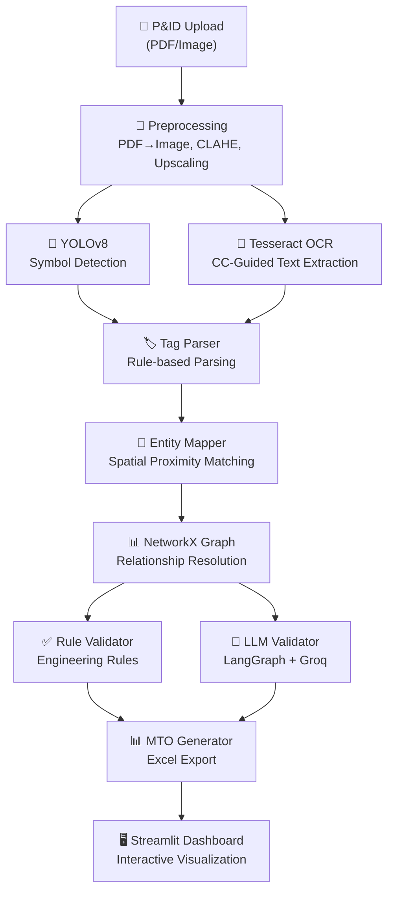
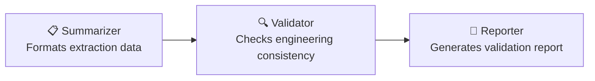

# 🏗️ P&ID Document Intelligence & MTO Extraction Pipeline

**A July 2026 document-intelligence prototype that converts P&ID (Piping & Instrumentation Diagram) drawings into reviewable Material Take-Off (MTO) records using computer vision, OCR, graph mapping, and optional LLM validation.**


---

## 🎯 Problem Statement

In EPC (Engineering, Procurement, Construction) projects, extracting Material Take-Off data from P&ID drawings is a **manual, time-consuming, and error-prone process**. Engineers spend hours identifying valves, instruments, equipment, and piping components from complex drawings and tabulating them into MTO spreadsheets.

This project demonstrates the following assisted extraction workflow:

```
📄 P&ID Drawing → 🎯 Symbol Detection → 📝 OCR Text Extraction → 🔗 Graph Mapping → 🤖 AI Validation → 📊 MTO Excel
```

---

## 🏗️ Architecture



---

## ✨ Key Features

| Feature | Technology | Description |
|---------|-----------|-------------|
| **Symbol Detection** | YOLOv8s (custom-trained) | Detects valves, instruments, equipment, piping components |
| **Text Extraction** | Tesseract OCR + Connected-Component Analysis | CC-guided OCR finds text-like blobs first, then OCR reads only those regions — avoids pipe-line noise |
| **Tag Parsing** | Regex + engineering tag conventions | Parses examples such as `FV-101`, `PI-202`, and `6"-PA-1001` into structured data with OCR correction heuristics |
| **Entity Mapping** | Spatial Proximity | Associates detected symbols with their nearest text labels |
| **Graph Reasoning** | NetworkX | Builds relationship graph, resolves piping connections and instrument loops |
| **Rule Validation** | Deterministic Rules | Checks tag uniqueness, loop integrity, valve connections |
| **AI Validation** | LangGraph + Groq (Llama 3.3 70B) | 3-node agent: Summarize → Validate → Report |
| **MTO Generation** | openpyxl | Professional Excel with categories, formatting, confidence scores |
| **Web Dashboard** | Streamlit | Upload, detect, visualize graph, download MTO — all in one UI |
| **REST API** | FastAPI | Upload → Process → Download endpoints |

---

## 🚀 Quick Start

### Prerequisites

- Python 3.10+
- [Tesseract OCR 5.x](https://github.com/UB-Mannheim/tesseract/wiki) installed (Windows: `winget install UB-Mannheim.TesseractOCR`)
- (Optional) Groq API key for LLM validation — free at [console.groq.com](https://console.groq.com)

### 1. Clone & Install

```bash
git clone https://github.com/Venkateswara-Sahu/P-ID-Processing-MTO-Extraction-System.git
cd P-ID-Processing-MTO-Extraction-System

# Create virtual environment
python -m venv venv
venv\Scripts\activate        # Windows
# source venv/bin/activate   # Linux/macOS

# Install dependencies
pip install -r requirements.txt
```

### 2. Install Tesseract OCR

**Windows (recommended):**
```bash
winget install --id UB-Mannheim.TesseractOCR -e
```
Or download from: https://github.com/UB-Mannheim/tesseract/wiki

**Linux:**
```bash
sudo apt install tesseract-ocr
```

### 3. Configure Environment

```bash
copy .env.example .env   # Windows
# cp .env.example .env   # Linux/macOS

# Edit .env — add your Groq API key if you want LLM validation
# GROQ_API_KEY=gsk_your_key_here   (optional — pipeline works without it)
```

### 4. Add Your YOLOv8 Model

Place your trained weights at `models/best.pt`.

> **Training your own model:** Open `notebooks/01_yolo_training.ipynb` in Google Colab.  
> Dataset: [Roboflow P&ID Object Detection](https://roboflow.com) — requires a free Roboflow account.

**Before you train, read [`MODEL_DATASET_AUDIT.md`](MODEL_DATASET_AUDIT.md).**
It documents what is actually wrong with the shipped dataset and model:
498 test images that are byte-identical to training images, 7 groups of
duplicate class names, a 20,572× class imbalance, and a training recipe
whose `erasing=0.4` default was deleting symbols out of every image.

Two tools come with it:

```bash
# Merge duplicate classes, fix misspellings, dedupe, re-split leak-free
python tools/repair_dataset.py --src dataset/ --dst dataset_repaired/

# Per-class evaluation — shows how many classes were never even scored
python tools/evaluate_model.py --model models/best.pt --data dataset_repaired/
```

### 4b. Train on Google Colab

`notebooks/01_yolo_training.ipynb` is self-contained: the repository's
tools are **embedded in the notebook**, so it runs whether or not the
repo has been pushed. The data pipeline (download → repair → merge →
train → evaluate) has been dry-run end to end locally.

```
1. Open the notebook in Colab, Runtime → GPU (T4)
2. Set the key once:
     from google.colab import userdata
     userdata.put("ROBOFLOW_API_KEY", "<your key>")
3. Runtime → Run all
4. Download best.pt → copy to models/best.pt
```

The run produces a checkpoint with **218 classes**, not 229 — the
duplicate spellings were merged. The old 229-class checkpoint is not
interchangeable with it, and `tools/evaluate_model.py` refuses to
evaluate a model whose class list does not match the dataset's, so the
mismatch cannot produce a plausible-looking but meaningless mAP.

**What training will and will not fix.** Fine-tuning on the repaired
Roboflow set improves the 218 Roboflow classes, including the 139 that
had fewer than 50 training instances. It will **not** teach the model
your drawing style: `Centrifugal Pump` already has 2,013 instances and
mAP50 0.935, and it still misses 6 of 8 pumps on the sample P&ID,
because the glyph is drawn differently. For that you need target-style
data — see `MODEL_DATASET_AUDIT.md` §6.

### 4c. Build a target-style training set (optional but recommended)

The shipped model finds the valves on your drawings and **none** of the
vessels, columns, exchangers or reactors — not because of a data-volume
problem, but because the glyphs are drawn differently. `Centrifugal Pump`
already has 2,013 training instances and mAP50 0.935, and it still
misses 6 of 8 pumps on the sample P&ID.

Because the target style is clean thin black line art with no scan
noise, it can be **synthesised with exact ground truth**:

```bash
# 1. generate sheets in the target style (exact boxes, no annotation)
python tools/augment_target.py --count 600 --out data/target_style/generated/

# 2. merge them into the repaired Roboflow dataset (ids remapped by name)
python tools/merge_datasets.py \
    --base dataset_repaired/ \
    --extra data/target_style/generated/ \
    --dst dataset_merged/ \
    --extra-repeat 3
```

The glyphs come from `data/target_style/glyph_catalogue.yaml`, which was
extracted from `data/sample_pids/plant-pid.png` and verified box by box.
`tools/annotate_target.py` can propose boxes for new drawings
automatically (it found 7 of the 9 pumps and 9 of the 9 valves on the
sample) — but at this resolution it is ~70% accurate, so a human still
has to correct it. That is the point of a *semi-automatic* annotator:
a person fixes 5 boxes instead of drawing 30.

To generate the sheets:

```bash
python tools/augment_target.py --count 600 --out data/target_style/generated/
```

Then upload `dataset_merged/` to Colab and set `USE_TARGET_STYLE = True`
in the notebook's Step 3b.

> **Honest limitation:** synthetic sheets teach the model the *glyphs*.
> They do not teach real process topology or the noise of a scanned
> original. A handful of real annotated drawings from your own style
> would be better than any amount of generated data — and if you have
> them, that is the better path.

**Measured: it works.** 600 synthetic sheets → a YOLOv8n trained on
them → run on the real sample P&ID:

| | Shipped model | Trained on synthetic target style |
|---|---|---|
| Total detections | 11 | **26** |
| **Equipment detections** | **2** | **20** |
| Pumps / vessels / tanks / columns / exchangers / reactors | 2, and nothing else | 10 / 3 / 3 / 2 / 1 / 1 |

The classes the shipped model could not see at all are now detected on
the real drawing. Full method and caveats: `MODEL_DATASET_AUDIT.md` §6.7.

### 5. Run the Dashboard

```bash
streamlit run app/streamlit_app.py
```

Open **http://localhost:8501** → Upload a P&ID image or PDF → Click **Extract MTO**.

### 6. Run the Tests

```bash
pytest tests/ -q
```

The suite covers the tag parser, the OCR/entity mapping, the graph, the
MTO generator, the API, the class taxonomy, and an end-to-end pipeline
run on the sample drawing. It is the fastest way to check that a change
did not regress extraction quality.

### 7. Detection configuration

`TILE_SIZE` in `.env` must match the resolution the model was trained at.
The shipped model was trained at `YOLO_IMAGE_SIZE=640` on images that
were 640×640 and 1312×1312, so `TILE_SIZE=1312` reproduces the training
scale. Measured on the dataset's own validation split:

| Configuration | F1 |
|---|---|
| whole image, no tiling | 0.970 |
| tile 640 at native scale | 0.773 |
| tile 640 after a 1.6× upscale | 0.462 |
| **tile 1312 + drop boundary-cut detections** | **0.958** (on a 3936 px sheet) |

If you retrain at a different `imgsz`, set `TILE_SIZE` to match.

---

## 📂 Project Structure

```
P-ID-Processing-MTO-Extraction-System/
├── config/
│   └── settings.py              # Pydantic-Settings configuration
├── src/
│   ├── preprocessing/
│   │   ├── pdf_converter.py     # PDF → high-res images (PyMuPDF)
│   │   ├── image_tiler.py       # Tile large drawings for detection
│   │   └── enhancer.py          # CLAHE, denoise, upscaling
│   ├── detection/
│   │   ├── symbol_detector.py   # YOLOv8 inference wrapper
│   │   └── postprocessor.py     # Merge tiles + NMS deduplication
│   ├── ocr/
│   │   ├── text_extractor.py    # CC-guided Tesseract OCR engine
│   │   └── tag_parser.py        # ISA-5.1 tag parsing + OCR correction
│   ├── graph/
│   │   ├── entity_mapper.py     # Symbol-text spatial association
│   │   ├── graph_builder.py     # NetworkX graph construction
│   │   ├── class_map.py         # Model class → MTO category taxonomy
│   │   └── relationship_resolver.py  # Line assignment, loop detection
│   ├── validation/
│   │   ├── engineering_rules.py # Deterministic validation rules
│   │   ├── confidence_scorer.py # Weighted extraction confidence
│   │   └── llm_validator.py     # 3-node LangGraph agent (Groq)
│   ├── mto/
│   │   ├── mto_generator.py     # Excel MTO generation
│   │   └── templates.py         # Column & style definitions
│   └── pipeline.py              # Full pipeline orchestrator
├── app/
│   ├── api.py                   # FastAPI REST backend
│   └── streamlit_app.py         # Streamlit dashboard
├── tools/
│   ├── repair_dataset.py        # Merge duplicate classes, dedupe, leak-free re-split
│   ├── merge_datasets.py        # Merge a target-style dataset in, remapping ids by name
│   ├── evaluate_model.py        # Per-class evaluation; refuses class-list mismatches
│   ├── annotate_target.py       # Semi-automatic annotator for target-style drawings
│   └── build_notebook.py        # Regenerates the Colab notebook with tools embedded
├── tests/                       # 263 pytest tests
├── notebooks/
│   └── 01_yolo_training.ipynb   # Google Colab training notebook
├── models/                      # Place trained YOLOv8 weights here (best.pt)
├── data/
│   ├── sample_pids/             # Sample P&ID images for testing
│   ├── target_style/            # Seed annotations for the target-style training set
│   └── output/                  # Generated MTO files (git-ignored)
├── AUDIT_REPORT.md              # Codebase audit + fix roadmap
├── MODEL_DATASET_AUDIT.md       # Dataset + model audit (measured)
├── pytest.ini
├── .env.example                 # Environment variable template
└── requirements.txt
```

---

## 🔍 OCR Engine: Connected-Component Guided Tesseract

A key innovation of this pipeline is how it handles OCR on complex P&ID drawings. Standard full-image OCR fails because pipe lines, valve symbols, and equipment graphics create character-like shapes that overwhelm OCR engines.

**Our approach:**
1. **Binarize** the image with dual-threshold (fixed + adaptive) to make text clearly black on white
2. **Find text-like blobs** using connected-component statistics: height 12–130px, aspect ratio 0.15–12, fill ratio 0.08–0.90
3. **Group blobs** into word-level regions (merges `E`, `-`, `1001` into one group)
4. **Build an overlap mask** from these CC regions
5. **Run ONE Tesseract psm-11 call** on the full image
6. **Filter Tesseract's results** to only words overlapping the CC mask
7. **Post-process**: merge fragments, apply OCR correction heuristics (`Re1001` → `R-1001`)

In the recorded project test, this change reduced OCR processing from approximately **360 seconds to 7 seconds**. This is an implementation benchmark rather than a general performance guarantee; timing varies with image size and hardware.

---

## 🤖 LLM Validation Agent (LangGraph + Groq)

The validation pipeline uses a **3-node LangGraph agent** powered by **Groq** — only runs if `GROQ_API_KEY` is set:



> **Model:** `openai/gpt-oss-120b` (see `GROQ_MODEL` in `.env.example`).
> The previously-configured `llama-3.3-70b-versatile` was retired by Groq and
> returns HTTP 404, which made this stage silently never run. If LLM
> validation cannot run, the report says so explicitly and the MTO is
> flagged as degraded rather than passing off a rule-only report as a full
> validation result.

**Engineering validation rules** (deterministic, always run):
- `R001`: Tag completeness — every detected symbol should have a tag
- `R002`: Tag uniqueness — no duplicate tag IDs  
- `R003`: Instrument loop integrity — measurement + control elements
- `R004`: Low confidence flagging — entities needing human review
- `R005`: Orphan node detection — isolated components
- `R006`: Valve connection check — inlet + outlet requirements

These findings are written to the **"Rule Validation"** sheet of the MTO
workbook, so the spreadsheet carries machine-readable validation data and
not just the LLM's prose.

---

## 🛠️ Tech Stack

| Layer | Technology | Version |
|-------|-----------|---------|
| **Detection** | YOLOv8 (Ultralytics) | ≥8.2 |
| **OCR** | Tesseract + pytesseract | 5.4 / ≥0.3.10 |
| **OCR Fallback** | EasyOCR | ≥1.7 |
| **CV** | OpenCV | ≥4.9 |
| **Graph** | NetworkX | ≥3.2 |
| **LLM** | Groq (Llama 3.3 70B) | — |
| **Agents** | LangGraph | ≥0.2 |
| **Backend** | FastAPI | ≥0.110 |
| **Frontend** | Streamlit | ≥1.35 |
| **Output** | openpyxl + pandas | ≥3.1 / ≥2.1 |
| **Config** | Pydantic Settings | ≥2.1 |

---

## 📊 Sample Output

### Streamlit Dashboard
- Upload P&ID → real-time progress → annotated image overlay
- Interactive PyVis entity relationship graph
- Tabular MTO with confidence scores
- One-click Excel + JSON + annotated image download

### MTO Excel

Items are grouped by category (Equipment, Valves, Instruments, Piping, Other)
and **identical items are aggregated into a single line with a real
quantity**, because an MTO is a procurement document:

| Item | Tag Number | Description | Type | Size | Qty | Confidence |
|------|------------|-------------|------|------|-----|-----------|
| 1 | E-1003, E-1006, E-1008 | Heat Exchanger | Equipment | — | 3 | 69% |
| 2 | P-101A, P-101B | Centrifugal Pump | Equipment | — | 2 | 48% |
| 3 | HV-1001, HV-1002, HV-1003 | Gate Valve | Valve | 4" | 3 | 62% |

The workbook contains three sheets: **Material Take-Off**, **Rule
Validation** (the deterministic R001–R006 findings) and **LLM Report**.

---

## ⚠️ Current Limitations

- **YOLO model accuracy** depends on the P&ID symbol style it was trained on. The included training notebook uses a publicly available Roboflow dataset. Re-train on your own drawings for best results.
- **OCR accuracy** on very small or overlapping labels may be limited without a higher-resolution scan. The OCR confidence threshold is deliberately low (`0.2`) because Tesseract's per-word confidence is unreliable on line art — the tag parser rejects noise instead.
- **LLM validation** requires a free Groq API key (`GROQ_API_KEY` in `.env`). Without it, only rule-based validation runs, and the report says so.
- **No pipe-run tracing.** The model detects *symbols*; it has no "pipe segment" class, so piping connectivity and line numbers are inferred from proximity and label association rather than traced along the actual pipe. This is the largest remaining accuracy gap.
- **Symbol recall is limited by the trained model**, not by the pipeline: on the included sample, roughly 25–30 symbols are visible and about 11 are detected.
- **Prototype scope**: extracted records require human review; the project has not been validated on a representative industrial drawing corpus.
- **Tag conventions**: rule-based parsing is inspired by common engineering tag formats and is not a certification of complete ISA-5.1 compliance.

---

## 📝 License

This project is built for educational and portfolio purposes. MIT License.

---

## 👨‍💻 Author

**Venkateswara Sahu**
- GitHub: [Venkateswara-Sahu](https://github.com/Venkateswara-Sahu)
- LinkedIn: [venkateswara-sahu](https://linkedin.com/in/venkateswara-sahu)
- Email: venkateswarasahu000@gmail.com
